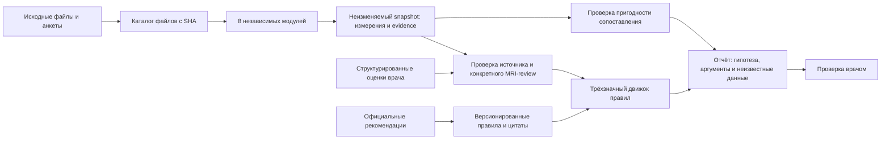

# DorsopathyCDS

Локальная платформа модулей наблюдений и исследовательское ядро поддержки
клинических гипотез при боли в пояснице.
На входе — изображения, сигналы, исходные ответы пациента и оценки врача.
На выходе — измерения и модельные признаки с evidence, затем результат проверки
применимых правил, неизвестные данные и прямые цитаты источников.

Клиническая гипотеза: **дискогенная пояснично-крестцовая радикулопатия
у взрослых**, по диагностической триаде КР №777, раздел 2.2, страница 12.
Правило исполняется явно через `all` / `any` / сравнения, без нейросети в решающем ядре.
Формализация пока требует клинической проверки. Одобрение рекомендаций не означает
одобрение этого программного обеспечения.

Новые raw-провайдеры `0.2.0` добавлены отдельно от прежних `0.1.0`:
[что работает, как запускать и читать результаты](docs/run_raw_modules_ru.md).
Дополнительно реализовано цитируемое правило срочного направления NICE NG127
по исходным ответам пациента; это скрининговое действие, не диагноз.
Условия и действие доступны в `module_report`, версия полного отчёта `2.0`.

Готовый архив одного учебного пациента с входами восьми модулей и полным прогоном: [состав, результаты и запуск](docs/synthetic_patient_ru.md).

## Платформа для параллельной разработки модулей

Начните с [общей архитектуры](docs/architecture_ru.md),
[разделения задач](docs/parallel_development_ru.md) и
[каталога модулей и инструкции разработчика](docs/module_development_ru.md).

[Пакет готовых заданий агентам для полного прогона](docs/agent_tasks/README.md):
интегратор, задачи платформы, МРТ, жалоб/осмотра, LiDAR, термографии, ЭМГ,
УЗИ, ANI/PMD и сопоставления данных; отдельно обучение дискового признака.
Для каждого есть владение файлами, зависимости и критерии приёмки.
Команда `python3 scripts/agent_task_prompt.py show T03` печатает общий контекст
и готовое задание выбранному агенту; `list` показывает весь список.

[Подбор инструментов и данных независимыми агентами](research/reuse/README.md):
отдельные ветки/worktrees по модальностям, критерии выбора и исследовательские отчёты.
Подбор 8/8 модулей завершён: [общая матрица компонентов](research/reuse/summary_ru.md)
и [назначения/ветки/коммиты агентов](research/reuse/dispatch.json).

Реализован общий поток восьми модулей: загрузка исходных файлов → фоновые задания →
измерения/изображения → неизменяемый snapshot → отчёт с происхождением фактов и
прямыми цитатами. [Инструкция полного запуска](docs/run_full_flow_ru.md) объясняет
учебный пример, настоящий MRI, форматы сенсоров и ограничения.

```sh
cd /Users/andrew/Projects/DorsopathyCDS
PYTHONPATH=src python3 -m dorsopathy_platform serve --store var/multimodal --port 8766
```

Откройте <http://127.0.0.1:8766/> и нажмите «Запустить пример всех модулей».
Учебные данные проходят через настоящие вычислительные провайдеры; TSS inference
на реальном открытом MRI проверен отдельно. Контуры анатомии/ROI не означают
автоматическое обнаружение грыжи. [Что реализовано](docs/implementation_status_ru.md).

Отдельный свежий SpineNet inference на публичной sagittal T2 уже завершён:
[оценки стеноза и грыжи, evidence и изолированный runtime](docs/mri_pathology_ru.md).
Модельные категории требуют проверки и не заполняют клиническое правило.

Цель для остальных модулей — исходные файлы → автоматическое извлечение
признаков → проверяемые факты → применимое клиническое правило с цитатой.
[Входы, аналитика, клиническая роль и независимые задания](docs/raw_modules_clinical_contract_ru.md)
фиксируют, где пока нужны ручные ROI/ориентиры и какие методы требуют проверки.

```sh
PYTHONPATH=src python3 -m dorsopathy_platform run-flow \
  --store var/cli-example --output var/cli-example-report.json
```

Настоящие публичные МРТ, УЗИ поясницы, ЭМГ, радиометрический кадр спины и 3D depth
уже прогнаны отдельными случаями. [Инструкция и происхождение реальных примеров](docs/real_data_demo_ru.md).
Страница обзора: <http://127.0.0.1:8766/real-examples>; для неё добавить
`--example-catalog var/real-inputs/catalog.json` при запуске сервера.

Старая команда `demo` сохранена как минимальный пример двух синтетических провайдеров.

```sh
PYTHONPATH=src python3 -m dorsopathy_platform validate-result \
  --request examples/platform/module_request.json \
  --result examples/platform/module_result.json
PYTHONPATH=src python3 -m dorsopathy_platform contracts --output var/contracts-v1
```

## Понятная демонстрация в браузере

Запустите сервер и оставьте терминал открытым:

```sh
cd /Users/andrew/Projects/DorsopathyCDS
PYTHONPATH=src python3 -m dorsopathy_cds serve --port 8765
```

Откройте http://127.0.0.1:8765/ в браузере. Первый учебный пример уже заполнен.
Слева — исходные оценки; справа — результат и три условия с цитатами из источника.
Измените соответствие МРТ на «Не оценено» и нажмите «Проверить условия»;
затем выберите несоответствие и повторите проверку. Так видны три состояния результата.
На этой странице все факты помечаются как синтетические демонстрационные данные.

[Короткая инструкция: как пользоваться и понимать результат](docs/using_demo_ru.md).

## Запуск примера через CLI

Нужен Python 3.9+. Сторонние библиотеки и скачивание весов не требуются.

```sh
cd /Users/andrew/Projects/DorsopathyCDS
PYTHONPATH=src python3 -m dorsopathy_cds evaluate examples/01_supported_with_imaging.json --output reports/supported.json
open -a TextEdit reports/supported.json
```

Все пять примеров синтетические:

| Файл в `examples/` | Проверяемая ситуация | Результат |
|---|---|---|
| `01_supported_with_imaging.json` | Три пункта подтверждены врачебными оценками | `met` |
| `02_unknown_concordance.json` | Не оценено соответствие изображения клинике | `indeterminate` |
| `03_discordant_imaging.json` | Врач указал несоответствие изображения клинике | `not_met` |
| `04_no_imaging_performed.json` | Клинические пункты выполнены, исследование явно не выполнялось | `met`, сопоставление снимков `not_applicable` |
| `05_warning_signs_not_absent.json` | Не выполнен пункт об отсутствии настораживающих признаков | `not_met` |

`met` означает поддержку гипотезы условиями правила и требует врачебной проверки.
`not_met` означает невыполнение этого правила; заболевание не исключается.
`indeterminate` означает недостаточность данных. Процент вероятности не вычисляется.

В отчёте `results[0].trace` показывает вычисление дерева; `leaves` — результаты
каждого условия; `citations` — точные короткие выдержки со страницами и ссылкой на
официальный источник. `citation_refs` связывает условие с выдержкой через
`doc_id` / `quote_id`. Тексты выдержек хранятся один раз в реестре источников.
`source_documents` содержит адрес PDF, его хеш и редакцию первоисточника.
`missing_fact_ids` включает все неизвестные факты, а `decisive_missing_fact_ids` —
неизвестные факты в ветвях, необходимых для разрешения неопределённого результата.
Хеш каталога позволяет установить использованную редакцию правил и источников.

## Локальный API

```sh
PYTHONPATH=src python3 -m dorsopathy_cds serve --port 8765
```

В другом терминале:

```sh
curl http://127.0.0.1:8765/health
curl http://127.0.0.1:8765/rules
curl -H 'Content-Type: application/json' --data-binary @examples/01_supported_with_imaging.json http://127.0.0.1:8765/evaluate
```

API слушает только loopback-адреса. `GET /rules` отдаёт правила вместе с реестром
цитат; `POST /evaluate` возвращает тот же отчёт, что CLI. Запрос ограничен 64 KiB.
Обработка не записывает случаи на диск; CLI сохраняет отчёт только с `--output`.

## Контракт данных

Объект случая содержит `population: "adult"`, необязательный псевдоним `case_id`
и `facts`. Факты приведены в примерах, их контракт:

| Факт | Допустимое значение | Кто устанавливает |
|---|---|---|
| `clinical.specific_cause_warning_signs_absent` | `true` / `false` / `null` | Врач после клинической оценки |
| `clinical.radiculopathy_signs_and_positive_tension_tests` | `true` / `false` / `null` | Врач после неврологического осмотра и тестов |
| `imaging.study_status` | `not_performed` / `performed_result_available` / `null` | Известный статус исследования |
| `clinical.imaging_clinical_concordance` | `true` / `false` / `null` | Врач при доступном результате исследования |

У каждого известного факта обязательны `origin` (`clinician_entered` либо
`synthetic_demo`) и `assessment_ref` — идентификатор оценки, без текста карты пациента.
Отсутствующий факт и `value: null` означают неизвестное. Выполненное исследование с
недоступным результатом передаётся как неизвестный статус; отсутствие загруженного
файла не означает `not_performed`. Для невыполненного исследования соответствие
клинике оставляют неизвестным, а сервис обозначает его как неприменимое.

Поля происхождения дают трассировку, но не удостоверяют квалификацию автора или
подлинность осмотра. Аутентификация и электронная подпись пока не реализованы.

## Модули и следующий этап

[Контракты модулей и порядок разработки](docs/module_contracts_and_roadmap_ru.md):
что получать от жалоб, осмотра, МРТ и приборов; что уже работает и какие
компоненты переиспользовать. Реализованный состав указан в инструкции полного запуска.

## Архитектура и границы



Тяжёлый MRI inference остаётся отдельным процессом; остальные провайдеры принимают
строго описанные статические входы. Наблюдения содержат версию, качество, происхождение
и ссылки на доказательства. Отчёт использует явные врачебные оценки; автоматический
переход от численного измерения к клиническому условию потребует отдельного
проверяемого правила. Нормальное МРТ или датчик не являются основанием для вывода
о симуляции или психогенной боли.

Структура репозитория:

- `src/dorsopathy_cds/` — движок, сервис, CLI, HTTP, каталог правил и цитат.
- `src/dorsopathy_platform/` — контракты, задания, хранилище, snapshots и CLI платформы.
- `src/dorsopathy_modules/` — восемь независимых провайдеров и сохранённые минимальные synthetic demo.
- `tests/` — проверки логики, контрактов и HTTP.
- `examples/` — синтетические случаи.
- `docs/` — клиническая формализация и область применения.
- `research/sources/` — локальные первоисточники отдельно от программы.
- `reports/` — результаты запуска, исключены из Git.
- `var/` — локальная SQLite и артефакты платформы, исключены из Git.

Подробности: [сопоставление с клиническими рекомендациями](docs/clinical_mapping_ru.md),
[границы применения и подготовка к регистрации](docs/regulatory_scope_ru.md),
[трассировка требований и проверок](docs/requirements_traceability_ru.md).
Это локальный репозиторий; удалённый Git-репозиторий не настроен.

## Проверка и следующий этап

```sh
PYTHONPATH=src python3 -m unittest discover -s tests -v
python3 scripts/verify_sources.py
```

Тесты проверяют программную логику, а не диагностическую точность. Следующий этап —
врачебная проверка формализации этой триады, затем отдельные правила безопасности
и неспецифической боли со своими источниками; обучение и проверка MRI-классификатора
патологии, поддержка реальных приборных экспортов и аппаратного захвата.
Автономная постановка диагноза и профили рекомендаций США/Кореи в эту версию не входят.
