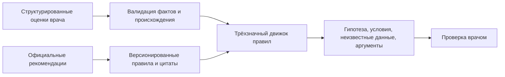

# DorsopathyCDS

Локальное исследовательское ядро поддержки клинических гипотез при боли в пояснице.
На входе — структурированные оценки врача; на выходе — результат проверки правила,
его условия, неизвестные данные, ссылки на прямые цитаты и происхождение входных фактов.

В версии 0.1 реализована одна гипотеза: **дискогенная пояснично-крестцовая радикулопатия
у взрослых**, по диагностической триаде КР №777, раздел 2.2, страница 12.
Правило исполняется явно через `all` / `any` / сравнения, без нейросети в решающем ядре.
Формализация пока требует клинической проверки. Одобрение рекомендаций не означает
одобрение этого программного обеспечения.

## Понятная демонстрация в браузере

Запустите сервер и оставьте терминал открытым:

```sh
cd /Users/andrew/Projects/DorsopathyCDS
PYTHONPATH=src python3 -m dorsopathy_cds serve --port 8765
```

Откройте http://127.0.0.1:8765/ в браузере. Первый учебный пример уже заполнен.
Слева — исходные оценки; справа — результат и три условия с цитатами из источника.
Измените соответствие МРТ на «Не оценено» и нажмите «Проверить условия»;
затем выберите несоответствие и повторите проверку. Так видны три состояния результата.
На этой странице все факты помечаются как синтетические демонстрационные данные.

[Короткая инструкция: как пользоваться и понимать результат](docs/using_demo_ru.md).

## Запуск примера через CLI

Нужен Python 3.9+. Сторонние библиотеки и скачивание весов не требуются.

```sh
cd /Users/andrew/Projects/DorsopathyCDS
PYTHONPATH=src python3 -m dorsopathy_cds evaluate examples/01_supported_with_imaging.json --output reports/supported.json
open -a TextEdit reports/supported.json
```

Все пять примеров синтетические:

| Файл в `examples/` | Проверяемая ситуация | Результат |
|---|---|---|
| `01_supported_with_imaging.json` | Три пункта подтверждены врачебными оценками | `met` |
| `02_unknown_concordance.json` | Не оценено соответствие изображения клинике | `indeterminate` |
| `03_discordant_imaging.json` | Врач указал несоответствие изображения клинике | `not_met` |
| `04_no_imaging_performed.json` | Клинические пункты выполнены, исследование явно не выполнялось | `met`, сопоставление снимков `not_applicable` |
| `05_warning_signs_not_absent.json` | Не выполнен пункт об отсутствии настораживающих признаков | `not_met` |

`met` означает поддержку гипотезы условиями правила и требует врачебной проверки.
`not_met` означает невыполнение этого правила; заболевание не исключается.
`indeterminate` означает недостаточность данных. Процент вероятности не вычисляется.

В отчёте `results[0].trace` показывает вычисление дерева; `leaves` — результаты
каждого условия; `citations` — точные короткие выдержки со страницами и ссылкой на
официальный источник. `citation_refs` связывает условие с выдержкой через
`doc_id` / `quote_id`. Тексты выдержек хранятся один раз в реестре источников.
`source_documents` содержит адрес PDF, его хеш и редакцию первоисточника.
`missing_fact_ids` включает все неизвестные факты, а `decisive_missing_fact_ids` —
неизвестные факты в ветвях, необходимых для разрешения неопределённого результата.
Хеш каталога позволяет установить использованную редакцию правил и источников.

## Локальный API

```sh
PYTHONPATH=src python3 -m dorsopathy_cds serve --port 8765
```

В другом терминале:

```sh
curl http://127.0.0.1:8765/health
curl http://127.0.0.1:8765/rules
curl -H 'Content-Type: application/json' --data-binary @examples/01_supported_with_imaging.json http://127.0.0.1:8765/evaluate
```

API слушает только loopback-адреса. `GET /rules` отдаёт правила вместе с реестром
цитат; `POST /evaluate` возвращает тот же отчёт, что CLI. Запрос ограничен 64 KiB.
Обработка не записывает случаи на диск; CLI сохраняет отчёт только с `--output`.

## Контракт данных

Объект случая содержит `population: "adult"`, необязательный псевдоним `case_id`
и `facts`. Факты приведены в примерах, их контракт:

| Факт | Допустимое значение | Кто устанавливает |
|---|---|---|
| `clinical.specific_cause_warning_signs_absent` | `true` / `false` / `null` | Врач после клинической оценки |
| `clinical.radiculopathy_signs_and_positive_tension_tests` | `true` / `false` / `null` | Врач после неврологического осмотра и тестов |
| `imaging.study_status` | `not_performed` / `performed_result_available` / `null` | Известный статус исследования |
| `clinical.imaging_clinical_concordance` | `true` / `false` / `null` | Врач при доступном результате исследования |

У каждого известного факта обязательны `origin` (`clinician_entered` либо
`synthetic_demo`) и `assessment_ref` — идентификатор оценки, без текста карты пациента.
Отсутствующий факт и `value: null` означают неизвестное. Выполненное исследование с
недоступным результатом передаётся как неизвестный статус; отсутствие загруженного
файла не означает `not_performed`. Для невыполненного исследования соответствие
клинике оставляют неизвестным, а сервис обозначает его как неприменимое.

Поля происхождения дают трассировку, но не удостоверяют квалификацию автора или
подлинность осмотра. Аутентификация и электронная подпись пока не реализованы.

## Модули и следующий этап

[Контракты модулей и порядок разработки](docs/module_contracts_and_roadmap_ru.md):
что получать от жалоб, осмотра, МРТ и приборов; что уже работает и какие
компоненты переиспользовать. Ближайший фокус — наблюдения и MRI-провайдеры.

## Архитектура и границы



Код анализа снимков остаётся в отдельных проектах. Адаптеры МРТ, ЭМГ, УЗИ, LiDAR,
тепловизора и сенсоров здесь ещё не подключены. Их наблюдения в дальнейшем могут
поступать отдельными фактами с моделью, версией, качеством и ссылкой на измерение.
Переход от такого наблюдения к клиническому условию потребует собственного
проверяемого правила. Нормальное МРТ или датчик не являются основанием для вывода
о симуляции или психогенной боли.

Структура репозитория:

- `src/dorsopathy_cds/` — движок, сервис, CLI, HTTP, каталог правил и цитат.
- `tests/` — проверки логики, контрактов и HTTP.
- `examples/` — синтетические случаи.
- `docs/` — клиническая формализация и область применения.
- `research/sources/` — локальные первоисточники отдельно от программы.
- `reports/` — результаты запуска, исключены из Git.

Подробности: [сопоставление с клиническими рекомендациями](docs/clinical_mapping_ru.md),
[границы применения и подготовка к регистрации](docs/regulatory_scope_ru.md),
[трассировка требований и проверок](docs/requirements_traceability_ru.md).
Это локальный репозиторий; удалённый Git-репозиторий не настроен.

## Проверка и следующий этап

```sh
PYTHONPATH=src python3 -m unittest discover -s tests -v
python3 scripts/verify_sources.py
```

Тесты проверяют программную логику, а не диагностическую точность. Следующий этап —
врачебная проверка формализации этой триады, затем отдельные правила безопасности
и неспецифической боли со своими источниками, и адаптер фактов из МРТ.
Автономная постановка диагноза и профили рекомендаций США/Кореи в эту версию не входят.
