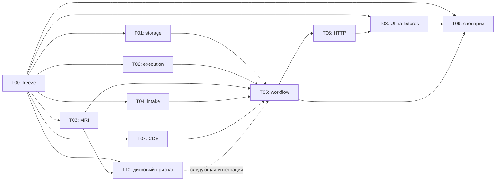

# Задания агентам: сквозной запуск DorsopathyCDS

Репозиторий: `/Users/andrew/Projects/DorsopathyCDS`, ветка `main`.
Архитектурная база кода: коммит `bd5cc16`. T00 начинает из актуальной `main`,
содержащей этот taskpack, и публикует новый freeze-commit.
Дата подготовки: 8 октября 2026 года.
Пакет задаёт будущую работу; перечисленные API, worker и UI ещё не реализованы.

## Какой результат собираем

Пользователь открывает локальный интерфейс, создаёт эпизод, загружает МРТ,
вводит жалобы и отдельные врачебные оценки, запускает обработку и видит:

1. Статусы заданий и понятное сообщение о неполных/непригодных данных.
2. Исходные срезы, анатомические контуры, проверяемые измерения и уровень.
3. Жалобы и оценки врача со своим происхождением.
4. Результат уже существующего клинического правила с условиями, прямыми
   цитатами, неизвестными данными и ссылками на использованные наблюдения.
5. Экспорт JSON/HTML, воспроизводимый по неизменяемому snapshot.

Первый MRI-результат — анатомия и доступные измерения канала/мышц из
существующего анализа. Контур анатомии, ROI диска и контур патологии имеют
разные подписи. Обучение выпячивания — отдельный T10, с собственной приёмкой.
Грыжа, компрессия корешка, клиническая степень стеноза и конус не появляются
в отчёте как оценённые признаки без соответствующего реализованного метода.

Отсутствующие приборы показываются как не подключённые. Эта итерация не
имитирует работу LiDAR/тепловизора/ЭМГ/УЗИ/ANI и не считает их согласованность.

## Три режима, которые должны различаться

| Режим | Что происходит | Что подтверждает |
|---|---|---|
| `synthetic` | Синтетические изображения/экспорт, анкета и клинические оценки | Полный программный путь; допустимы учебные `met/not_met/indeterminate` |
| `replay` | Импорт сохранённого реального MRI-анализа и проверенных файлов evidence | Импорт, просмотр и трассировка уже полученного результата; новый инференс не выполняется |
| `live` | Загруженный открытый MRI-файл реально обрабатывается отдельным worker | Работа модели/измерений, геометрии, контуров и интеграции; требует настроенного MRI-окружения |

Открытые MRI-данные обычно не содержат связанных жалоб и полноценного осмотра.
Синтетическая анкета рядом с таким снимком не становится клинической историей
этого пациента. В `replay/live` без связанных подтверждённых оценок CDS получает
неизвестные факты; нельзя демонстрировать подтверждение диагноза комбинацией
чужого MRI и придуманных симптомов. Связанность данных — явный параметр case manifest.
Политика исполняется: `unlinked/unknown` и обнаруженное смешение реального MRI
с синтетической клиникой не допускают подтверждающий CDS-case. Простого
предупреждения рядом с `met` недостаточно; флаг клиента `linked=true` не отменяет
противоречия происхождения.

Ввод клинического соответствия имеет второй шаг: пока MRI обрабатывается,
concordance неизвестен. После просмотра врач оценивает конкретный MRI result ID.
Создаётся новая clinical assessment и новый snapshot/report с явным повторным
использованием этого MRI-результата. Первый snapshot не изменяется; повторно
запускать модель ради новой врачебной оценки не требуется.

## Общая инструкция каждому агенту

Прочитай `AGENTS.md`, этот файл и свою карточку. Работай только в своей ветке
и отдельном worktree от результата T00. После T00 интегратор публикует точный
коммит базы; создавать ветки от старой базы автоматически не следует.
Тяжёлые модели и изменяемое `var/` не разделяются между параллельными запусками.

`ModuleRequest/ModuleResult` 1.0 уже реализованы. Их единственный источник —
`src/dorsopathy_platform/contracts.py` и схемы `schemas/v1/`; не добавляй
новые поля в Observation. Карта тела, автор оценки и дополнительные метаданные
хранятся в JSON-артефакте и связаны через evidence. Числового `model_score`
в контракте 1.0 нет. Новые транспортные схемы отделены от этого контракта.

Допустимые origins различаются: `patient_report`, `clinician_entered`,
`automatically_measured`, `model_predicted`, `synthetic_demo`.
`false`, `0`, `not_assessed`, `not_applicable`, `unreliable` не взаимозаменяемы.
Сохраняй время получения исходных данных, единицы, геометрию, состояние
нумерации, метод и версию модели. Неизвестное время/координаты — `null`.

Код исходных MRI-проектов читается и переиспользуется, но не изменяется
этим taskpack. Если без изменения upstream пройти сценарий нельзя, покажи
интегратору конкретную ошибку и минимальный patch-предложение.
Веса, публичные исследования, реальные пациентские данные, окружения и
runtime-отчёты не помещаются в Git; fixtures в Git — синтетические.

Делегирование общей платформы: только T01 меняет `storage.py`, только T02 —
`orchestration.py`; T00 владеет схемами, общими портами, bootstrap, CLI и сборкой.
Остальные задачи создают собственные файлы, перечисленные в карточках.
Не исправляй чужой компонент при интеграционном падении: сообщи его владельцу.

Все межкомпонентные вызовы берутся из frozen интерфейсов T00. Если зависимость
не готова, используй тестовый double по этому интерфейсу. Fake не должен
прятаться в production-ветке или выдавать синтетический ответ за реальный.

Результат задачи: коммит, список изменённых файлов, команда запуска/проверки,
выходной пример, тестовый результат и конкретные ограничения/зависимости.
Не завершай задачу одним планом. Не меняй глобальные Git-настройки и не публикуй
репозиторий: проект локальный.

## Задачи и зависимости

| ID | Задание | Начать | Полная приёмка зависит от |
|---|---|---|---|
| T00 | Контракты, владение, сборка | Сразу | Интеграционные сдачи T01–T09 |
| T01 | Каталог артефактов, загрузка и storage | После freeze T00 | — |
| T02 | Фоновое выполнение и отдельные процессы | После freeze T00 | T01; worker-double до T03 |
| T03 | MRI-адаптер, worker и изображения evidence | После freeze T00 | T01, T02 для live |
| T04 | Анкета и структурированные оценки врача | После freeze T00 | — |
| T05 | Workflow одного эпизода | После freeze T00 на doubles | T01, T02, T03, T04, T07 |
| T06 | Платформенный HTTP | После freeze T00 на fake application | T01, T05 |
| T07 | Snapshot → клинический отчёт | После freeze T00 на fixtures | T04 |
| T08 | Интерфейс и просмотр evidence | После freeze T00 на API fixtures | T03, T06, T07 |
| T09 | Сквозные сценарии и приёмка | После freeze T00: писать сценарии | T01–T08 |
| T10 | Обучение дискового признака | Параллельно после аудита данных | T03 для end-to-end проверки |



Независимая разработка идёт по frozen фикстурам; стрелки обозначают зависимости
окончательной интеграции. T00 после freeze продолжает собирать результаты,
а не остаётся задачей, которую нужно «сдать целиком» до запуска всех остальных.

Если доступны три агента плюс интегратор: первая волна T01/T02/T04,
вторая T03/T05/T07, третья T06/T08/T09. Незавершённые зависимости во второй
и третьей волнах заменяются doubles только в tests до совместной приёмки.
При большем числе исполнителей T08/T09 начинают на fixtures уже в первой волне.
На одном Mac только один live MRI-worker; обычные tests/fixtures идут параллельно.
У T10 отдельный бюджет обучения, он не занимает MRI-слот незаметно для остальных.

## Что фиксирует T00 до старта

Создаёт `docs/e2e_contracts_ru.md`, транспортные schemas/API fixtures и
freeze-commit. В нём согласованы:

- `CaseManifest`: episode, явно указанная взрослая популяция, режим,
  связанность источников, artifact IDs, выбранные версии модулей/протокол,
  явный выбор конфликтующих клинических оценок.
- `WorkflowRun`: сохранённые IDs заданий, состояния ветвей, snapshot ID,
  ссылки на клинический отчёт и evidence, предупреждения и режим.
- `EpisodeReport`: snapshot/hash, клинический case и lineage, результат
  существующего CDS, versions/catalog hash, перечень ограничений; сохранённые
  manifest/selection и редакция правил/цитат. Старый export читается из сохранённого
  отчёта и не пересчитывается через текущий каталог.
- Upload API, artifact lookup, dispatcher, workflow/application, worker
  exchange и доступ CDS-адаптера к подтверждающим артефактам.
- Workflow idempotency: canonical manifest hash, одинаковый key+manifest
  возвращает тот же run, иной manifest с тем же key даёт 409. Финализация
  snapshot/report выполняется одной CAS-операцией по persisted run state.
- Startup: прерванные running → явный failed, повторная доставка saved queued,
  восстановление workflow и его финализации по сохранённым job IDs.
- Селекторы evidence: исходный файл + кадр/ось/индекс/координаты, PNG,
  contour/ROI/линия измерения. Один формат для MRI-адаптера и viewer.

План транспортных операций: создать эпизод, загрузить файл в эпизод,
получить доступный модуль, запустить workflow, опрашивать статусы, прочитать
фиксированный snapshot/отчёт, скачать разрешённый artifact. Точные маршруты,
request/response и коды ошибок определяет freeze, а не каждый агент отдельно.

Целевые CLI `serve` и `run-flow` добавляет T00 при сборке. Их нет в текущем
CLI; до сдачи taskpack инструкция запуска не должна выдавать их за работающие.

## Критерии готовности полного прогона

- Одна документированная команда запуска сервера, одна инструкция live/replay.
- UI проходит создание эпизода → upload → intake → run → poll → просмотр → export.
- В live есть свежий запуск настоящего MRI-провайдера на известном открытом
  исследовании, а не только чтение старого cache. Источник/лицензия/хеш зафиксированы.
- Минимум одно пригодное MRI-наблюдение открывает правильный исходный кадр,
  анатомический контур и измерение с единицами. Если серия не позволяет площадь,
  выбирается подходящий пример или явно демонстрируется неполный результат.
- Синтетический полный случай даёт три проверенные ветви CDS; открытый MRI
  без связанной клиники не даёт искусственно подтверждённого диагноза.
- Сбой MRI, неизвестный осмотр, конфликт оценок и неподтверждённые уровни
  видны пользователю; независимые результаты не исчезают.
- Snapshot и экспорт не меняются после новых заданий. Перезапуск сервера
  позволяет открыть сохранённый отчёт и evidence. Обновление каталога/selection
  также не меняет старый report/HTML; новая оценка имеет новый report ID.
- Проверки проходят; reviewer видит список настоящих, replay и синтетических
  компонентов. T10 принимается отдельно по обучению и отложенной оценке.

## Как дать задание агенту

Каждая карточка в `tasks/` — готовая инструкция. Получить общий контекст
вместе с конкретной карточкой:

```sh
cd /Users/andrew/Projects/DorsopathyCDS
python3 scripts/agent_task_prompt.py list
python3 scripts/agent_task_prompt.py show T03
```

Вывод `show` можно целиком передать агенту. Назначение задач и создание
worktrees выполняет интегратор T00; helper только печатает инструкции.
