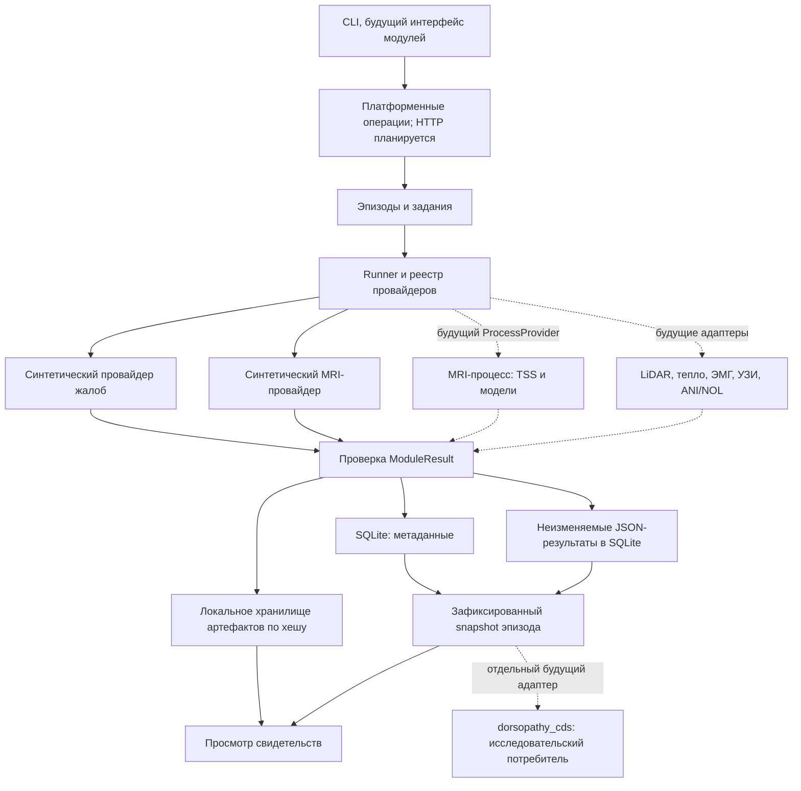
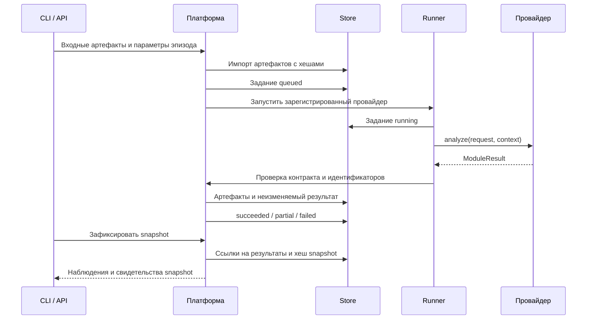

# Архитектура модулей наблюдений Dorsopathy

Дата: 8 октября 2026 года. Рабочее архитектурное решение.

## Границы системы

Основа — модульный монолит: одна Python-платформа управляет эпизодами,
заданиями, контрактами и хранением. Аналитические провайдеры развиваются
независимо и возвращают наблюдения. Для тяжёлого MRI-инференса предусмотрены
отдельный процесс и окружение; платформа не импортирует `torch`, TSS
или MuscleMap. Для первого демонстрационного runner достаточно потоков
одного процесса; это не реализация изоляции тяжёлых моделей.

`dorsopathy_cds` сохраняется отдельно как потребитель структурированных
клинических фактов. Число из измерительного модуля не превращается
автоматически в клинический boolean. Пациентская жалоба, измерение,
предсказание модели и врачебное суждение имеют различное происхождение.

## Контракт провайдера, версия 1.0

В коде порт — `ProviderProtocol.analyze(request: dict, context: ProviderContext) -> dict`;
возвращаемый словарь проверяется как `ModuleResult`. `ModuleRegistry`
предоставляет `register/get/describe`, а `ProviderContext.artifacts` — доступ
к хранилищу свидетельств. Провайдер не изменяет реестр эпизодов, чужие
результаты или snapshots. `JobRunner` предоставляет `submit/execute/execute_many`.

| Объект | Основные поля |
|---|---|
| Запрос | `job_id`, `episode_id`, `module_id`, `module_version`, `input_artifacts`, `parameters`, `protocol_id` |
| Результат | `result_id`, `job_id`, `episode_id`, `module_id`, `module_version`, `status`, `observations`, `artifacts`, `warnings`, `error` |
| Наблюдение | `concept`, `anatomy`, `assessment_status`, `quality`, `origin`, `value`, `unit`, `method`, `acquired_at`, `coordinate_frame`, `evidence_refs`, `model` |

Канонические типы, допустимые значения и обязательность полей определяют
`src/dorsopathy_platform/contracts.py` и схемы
`src/dorsopathy_platform/schemas/v1/{module_request,module_result}.schema.json`.
Таблица не является второй схемой данных.
Статус результата: `complete`, `partial` или `failed`. Статус задания:
`queued`, `running`, `succeeded`, `partial` или `failed`.
`complete` переходит в `succeeded`, а `partial` и `failed` сохраняют смысл.

Неизвестное, непригодное, неоценённое, неприменимое и отрицательное
наблюдения различаются. Ноль не используется как универсальная замена
отсутствующего измерения. Провайдер не выдаёт диагноз. Контракт 1.0 хранит
предсказанный признак и идентификаторы модели; отдельного `model_score`
и медицинской вероятности в нём пока нет.

Свидетельство — ссылка на исходный кадр, маску, ROI, ответы анкеты или
отрезок сигнала. Размер требует единиц и метода; уровень — состояния
нумерации; пространственное/временное сопоставление — координат, времени
и протокола. Точную проекцию MRI на поверхность тела эта архитектура
сама по себе не обеспечивает.
`acquired_at` — время получения исходных данных с часовым поясом, а не время
запуска модели; неизвестное время сохраняется как `null`. `coordinate_frame`
обозначает систему координат, если она известна. Координаты и индексы кадров
задаются селектором evidence; преобразование между разными системами не подразумевается.

## Хранение и воспроизводимость

- SQLite хранит метаданные и JSON-тела запросов, результатов и snapshots.
- Исходные файлы и производные артефакты лежат отдельно от кода и JSON.
  Их содержимое адресуется SHA-256; ссылки проверяются при импорте.
  `ArtifactStore.add_file/open` работают потоково, чтобы импорт и проверка
  большого MRI-файла не требовали чтения всего содержимого в память.
- JSON завершённого результата сохраняется неизменяемым. Исправление
  или повторная обработка создаёт новый результат, не заменяя предыдущий.
- Snapshot фиксирует конкретные `result_id` и их хеши. Новый результат
  становится доступен только в новом snapshot; старый остаётся воспроизводимым.
- Для воспроизведения сохраняются входные хеши, параметры, версии модуля,
  метода/модели, протокол и хеш результата. Хеш проверяет целостность;
  он не удостоверяет подлинность исследования или квалификацию автора.

Не следует включать реальные пациентские данные, веса и локальные отчёты
в Git. Состав требований к защите клинических данных определяется отдельно.

## Путь одного задания

MRI-анатомия и дисковый детектор — отдельные задания. Платформа после
пригодного анатомического результата передаёт его ROI/маски как входные
артефакты дисковому детектору. Детектор не вызывает анатомический модуль
самостоятельно. Версия и качество локализации остаются в происхождении
результата. Бинарная оценка bulging не означает контур или размер выпячивания.

## Что уже есть и что предстоит

| Слой | Состояние |
|---|---|
| Прежнее клиническое ядро и локальная CDS-страница | Уже существуют; работают с отдельными структурированными фактами |
| Контракт 1.0, реестр, runner, store и snapshots | Первый платформенный прототип этой ветки; готовность подтверждается контрактными и интеграционными тестами |
| `demo.complaints` и `demo.mri_anatomy` | Синтетические провайдеры в `src/dorsopathy_modules/demo/`; не реальный сбор жалоб и не инференс снимков |
| Настоящий MRI-анализ | Имеется в отдельных проектах; адаптер платформы ещё предстоит подключить |
| ProcessProvider, управление устройствами, восстановление заданий | Запланированы; не считать потоковый demo-runner их реализацией |
| Остальные приборы, зависимые конвейеры и CDS-адаптер | Планируются отдельными задачами после проверки входов и контрактов |

Локальная демонстрация: `PYTHONPATH=src python3 -m dorsopathy_platform demo --store var/platform-demo`.
Она запускает два синтетических провайдера параллельно и фиксирует snapshot.
Команда `python3 -m dorsopathy_platform contracts` при заданном `PYTHONPATH=src`
экспортирует схемы. Текущее CDS HTTP-приложение не изменяется.
Control-plane API `/v1/episodes`, `/v1/jobs`, `/v1/module-results`,
`/v1/snapshots`, `/v1/artifacts` — следующий этап, ещё не реализованный HTTP.

Создание задания с тем же `job_id` и идентичным запросом идемпотентно;
другой запрос с тем же ID отклоняется. Изоляция окружений, тайм-ауты,
отмена, повторные попытки, восстановление после завершения процесса и очередь
на GPU/MPS требуют отдельной реализации. До неё демонстрация не обещает устойчивость
длительного инференса или автоматическое восстановление после сбоя.

Правила параллельной разработки: [parallel_development_ru.md](parallel_development_ru.md).
Каталог первого этапа, пример провайдера и контрактные фикстуры:
[module_development_ru.md](module_development_ru.md).
