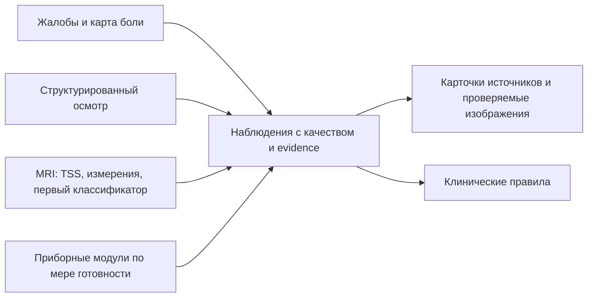

# Модули Dorsopathy: ожидаемые результаты и ближайшая разработка

Дата: 8 октября 2026 года. Рабочий план, а не перечень готовых возможностей.

Разработка сосредоточена на источниках данных. Общий решающий движок уже есть;
его полезность зависит от того, какие проверяемые наблюдения поступят от модулей.
Для текущего этапа сохраняем исходное ограничение: открытые данные и локальное
демо. Наличие оборудования и связанного мультимодального пациентского корпуса
пока не подтверждено.

## 1. Что должен выдавать каждый модуль

Результат модуля — наблюдение, измерение или оценка определённого признака.
Для каждой записи нужны область/сторона/уровень, исходное свидетельство,
метод, версия, качество и статус оценки. Сопоставление такого результата с
диагностической гипотезой выполняется отдельным клиническим правилом.

| Модуль | Ожидаемый выход | Что реально сделать первым | Текущее состояние |
|---|---|---|---|
| Жалобы и анамнез | Зоны и сторона боли, интенсивность, длительность, характер, иррадиация, связь с движением/позой, время изменения симптомов, неизвестные ответы | Анкета и карта тела с редактируемыми зонами; структурированный JSON; без обучения сети | Полноценной анкеты нет; нынешняя CDS-форма содержит только четыре факта для демонстрации одного правила |
| Клинический осмотр | Проверенные сила, чувствительность, рефлексы, тесты натяжения, сторона и область; кто/когда оценил; что не исследовано | Структурированный ручной ввод и ссылки на оценку специалиста | В CDS есть укрупнённые ручные факты; подробный осмотр ещё не реализован |
| МРТ: анатомия и измерения | Пригодные серии, предполагаемые уровни, маски и контуры анатомии, измерения в мм/мм²/мм³, исходный кадр и качество | Переиспользовать TSS/SpinoSarc; собрать карточки по уровням из сохранённых результатов | Частично работает в двух отдельных проектах; общего адаптера наблюдений нет |
| МРТ: признаки изменений | Для диска/уровня: конкретный признак, его оценка, score модели, источник и область анализа | Первый обучаемый признак — bulging на дисковом ROI SPIDER; альтернативные провайдеры оценивать отдельно | Подготовлены ROI и экспертные бинарные метки; диагностическая модель ещё не обучена |
| МРТ: мышцы | Мышечные маски справа/слева, площади и асимметрия; метод оценки интенсивности/жировой составляющей | Экспортировать имеющийся MuscleMap-анализ в общий формат | В SpinoSarc работает на пригодных кадрах; это не автоматический диагноз мышечного источника боли |
| LiDAR / глубина | Поверхность тела, ориентиры, положение туловища, углы и асимметрия с ошибкой измерения; позднее движение | Импорт облака точек/mesh, ручные ориентиры, простые геометрические измерения; Open3D — кандидат | Не подключён; устройство, протокол и пригодный открытый корпус ещё не выбраны |
| Термография | Радиометрическая температурная карта, ROI, температуры и разница симметричных областей; условия съёмки | Импорт радиометрического экспорта камеры, ручные/заданные ROI, сравнение температур | Не подключена; цветной JPEG сам по себе не даёт достоверную температуру |
| Поверхностная ЭМГ | Сигнал выбранной мышцы, контроль артефактов, активация и её временные/частотные показатели при известной задаче | Импорт сигналов, фильтрация, RMS/envelope, исследование асимметрии при сопоставимом протоколе | Не подключена; выбранных сигналов и протокола нет; не заменяет диагностическую игольчатую ЭМГ/ЭНМГ |
| УЗИ | Изображение выбранной структуры, масштаб и измерения: например, толщина/площадь мышцы и изменение при сокращении | Импорт статических изображений, ручная область и измерение при известном масштабе; автоматику выбирать под конкретную задачу | Не подключено; универсальной задачи «найти причину боли по УЗИ» в MVP не определено |
| ANI / PMD-100 | Индекс прибора во времени, качество, контекст измерения и синхронизация с событиями | При доступном устройстве — импорт его экспорта; отдельный исследовательский просмотр | Не подключены; версия устройства, экспорт, применимость к бодрствующим пациентам и доступный корпус не установлены |

Ни один из последних пяти модулей пока не имеет у нас проверенного готового
пути от открытых входных данных до диагностического заключения. Для статического
демо можно построить импорт и измерения; синтетические сигналы должны оставаться
явно учебными и не считаться доказательством работы прибора на пациенте.

## 2. Какие результаты МРТ уже получаем

### HTTP backend исходного MRI-проекта

Расположение: `/Users/andrew/.codex/worktrees/7179/med diploma`.

- Импорт classic single-frame MR DICOM, ZIP, MHA/NIfTI и проверка геометрии.
- TSS до `step2_output`: маски позвонков, дисков, канала и спинного мозга.
- Дисковые ROI и предполагаемые уровни с `numbering_status=needs_confirmation`.
- Исследовательские объём маски диска, AP-протяжённость маски канала и площадь
  её компонента, когда геометрические проверки допускают измерение.
- Непокрытые структуры и отсутствующие патологические провайдеры сохраняются
  как `not_assessed`.

### Отдельный форк SpinoSarc

Расположение: `/Users/andrew/Projects/SpinoSarc`.

- GUI использует TSS step1 для ориентиров уровней и soft-маски канала.
- На пригодной нативной аксиальной серии доступны контур и площадь маски канала
  по уровням, состояние совмещения и сведения о ближайшем срезе.
- MuscleMap выделяет восемь классов мышц: четыре группы с двух сторон;
  доступны площади и сравнение сторон.
- Экспорт содержит измерения и изображения, в том числе `findings.json`.

Пороговые флаги SpinoSarc по площади являются исследовательскими сравнениями;
они не равны клинической степени стеноза. Измеряется TSS-маска канала; её нельзя
без отдельной проверки переименовать в самостоятельную маску дурального мешка.
Интенсивностная оценка жира в мышцах не равна Dixon/PDFF.

### Следующий обучаемый компонент

В локальном аудите SPIDER: 64 пациента, 447 дисковых ROI; разбиение по пациентам
40 train / 13 development / 11 test. Это подготовка данных, не результат обучения.
Для bulging в этой выборке есть 216 положительных и 231 отрицательный ROI;
для бинарной грыжи — только 20 положительных ROI. Поэтому bulging сейчас
выглядит более обеспеченной локальными метками первой задачей.
Анатомическая нумерация дисков в этом корпусе не подтверждена: относительные
номера SPIDER не следует автоматически выдавать за L4–L5 и другие уровни.

Первый классификатор может выдавать бинарную оценку bulging на дисковой области.
Его ROI обозначает область анализа. Для контура патологического выпячивания и
его размеров нужны отдельная локализация/сегментация и геометрия измерения.
Бинарные метки не дают эталонов размера, стороны, миграции или компрессии корешка.

На первом эксперименте отдельно измерить качество с эталонными ROI и с
предсказанными ROI, исключить смешение пациентов и учитывать необработанные
случаи. TSS обучался в том числе на SPIDER, поэтому отложенные пациенты нового
классификатора сами по себе не доказывают независимую точность всего конвейера.

Грыжа с морфологией и размерами, центральный/фораминальный/латеральный стеноз,
компрессия корешка, самостоятельный мешок и патология конуса пока не реализованы.
Для них нужны отдельные задачи, выходные определения и пригодные метки.

## 3. Общий контракт — сначала на уровне наблюдений

Предлагаемые обязательные поля; это проект контракта, ещё не API нового сервиса:

| Поле | Зачем |
|---|---|
| `module_id`, `module_version` | Воспроизвести обработку и определить производителя результата |
| `episode_id`, `source_ref`, `acquired_at`, `protocol` | Связать результат с эпизодом и условиями получения; не считать разные даты одновременными |
| `processing_status` | Отличить complete/partial/failed/unavailable |
| `observations[].concept`, `anatomy` | Определить измеренную структуру, сторону, область и уровень |
| `value`, `unit`, `method` | Понять смысл числа и проверить способ расчёта |
| `assessment_status`, `quality`, `applicability` | Отличить отрицательный результат от неоценённого, непригодного и неприменимого |
| `origin`, `model_id`, `model_version` | Различить patient_report, clinician_entered, automatically_measured, model_predicted и synthetic_demo |
| `evidence_refs` | Открыть конкретный кадр, контур, ответы или временной фрагмент сигнала |
| `geometry`, `time_interval`, `numbering_status` | Сопоставить координаты/время и обозначить неподтверждённую нумерацию |
| `model_score` | Сохранить оценку модели отдельно от вероятности диагноза; не заполнять для обычного измерения |

Значение неизвестно сохраняется явно. Число 0, пустая маска и нормальный
результат — разные ситуации. Измерение канала или мышечной асимметрии не заполняет
автоматически клиническое соответствие МРТ жалобам.

Для первого сопоставления достаточно семантических областей и сторон.
Точная проекция внутренней МРТ-находки на внешнюю LiDAR-поверхность требует
отдельной регистрации и оценки погрешности. Нельзя просто присвоить боль на
коже над диском этому диску или корешку.

## 4. Порядок работ и критерии завершения

| Шаг | Работа | Что можно показать по завершении |
|---|---|---|
| A | Зафиксировать контракт наблюдений и подключить сохранённые MRI/SpinoSarc-результаты | Один открытый пример: карточки уровней, исходные кадры, контуры, реальные измерения и статусы качества без повторного инференса |
| B | Реализовать модуль жалоб и структурированный осмотр | Редактируемая карта боли и клинические данные с неизвестными ответами; видно, что сообщил пациент и что оценил врач |
| C | Обучить и оценить первый дисковый классификатор | Автоматическая оценка одного признака по ROI, результаты на отложенных пациентах, версия весов, список отказов и ошибок |
| D | Подключить результат классификатора к карточке MRI | На одном экране: исходный диск, анатомический контур, измерения и отдельная оценка признака; ROI не называется контуром патологии |
| E | Выбрать следующий приборный модуль по реально доступным данным/оборудованию | Одна конкретная измерительная задача с протоколом, экспортом, единицами и проверкой ошибки |

Начальный набор: **жалобы + структурированный осмотр + MRI-анатомия/измерения +
один MRI-признак**. Он даёт рабочие источники наблюдений и отдельную задачу
обучения для НИР. Остальные приборы добавляются по одному после выбора входного
формата, конкретного измерения и способа проверки.

## 5. Переиспользование

- [TotalSpineSeg](https://github.com/neuropoly/totalspineseg): готовый
  анатомический провайдер на nnU-Net, а не готовый набор всех патологий.
- [SpinoSarc](https://github.com/neuromath/SpinoSarc): desktop-путь загрузки,
  просмотра, канала и мышечных измерений; сохраняем отдельным проектом.
- [SPIDER](https://www.nature.com/articles/s41597-024-03090-w): открытый
  сегментационный корпус и основа уже подготовленных ROI.
- [SpineNet: выходные признаки](https://spinenet.readthedocs.io/en/latest/running-spinenet.html):
  кандидат категорий по уровням. Его запуск/веса у нас пока не подтверждены;
  [лицензия](https://github.com/rwindsor1/SpineNet/blob/main/LICENCE.md) ограничивает
  код, публичные веса и результаты некоммерческим исследованием. Стандартный
  выход не даёт отдельного контура и миллиметров грыжи.
- [LHC-Forms](https://lhcforms.nlm.nih.gov/): готовый рендерер анкет и сбор
  ответов; содержание и карта тела требуют нашей реализации.
- [Open3D](https://www.open3d.org/docs/release/introduction.html): обработка
  облаков точек, mesh, геометрия и визуализация; клинические ориентиры и протокол
  измерения положения тела остаются нашей задачей.

Дополнительный новый кандидат для MRI: [LSS-MRI, статья 2026](https://www.nature.com/articles/s41597-026-07138-x),
[данные Mendeley v4](https://data.mendeley.com/datasets/rgb77xm3jf/4),
[код](https://github.com/AISSLab2025/LSS-MRI-AISSLab-Dataset). Авторы заявляют
DICOM, анатомические маски, боксы отверстий и степени фораминального стеноза
по сторонам/уровням. Есть каркас выбора среза, локализации и классификации;
публичные специализированные веса не подтверждены. Корпус не скачан и
геометрия не проверена. Указание CC BY 4.0 одновременно с noncommercial
в описании требует уточнения прав. Рассматривать как кандидат данных и кода,
а не уже подключённый готовый детектор или сегментатор патологического контура.

## 6. Основания и ограничения приборных модулей

Предлагаемые измерительные выходы не доказывают источник боли:

- [IASP](https://www.iasp-pain.org/resources/terminology/?ItemNumber=1698-Pain)
  различает боль и ноцицепцию. Отрицательный результат датчика не опровергает
  жалобу; классификацию правдивости пациента из этих модулей не строим.
- [ACOEM, 2019, страница 6 PDF](https://acoem.org/acoem/media/PracticeResources/Diagnostic_Tests_for_Low_Back_Disorders-Apr-2019.pdf)
  описывает недостаточность доказательств для диагностического использования
  поверхностной ЭМГ, УЗИ и термографии при поясничных расстройствах. Это не
  запрещает вычислить измерение, но его диагностический смысл надо подтверждать
  отдельно. Температурная асимметрия не означает доказанное воспаление.
- [AANEM: электродиагностическая оценка радикулопатии](https://education.aanem.org/AssetListing/Monograph-Evaluation-of-persons-with-suspected-lumbosacral-and-cervical-radiculopathy-Electrodiagnostic-assessment-and-implications-for-treatment-and-outcomes-Part-II-2401/MUS27008-7972)
  рассматривает диагностическую игольчатую ЭМГ. Поверхностный сигнал с
  паравертебральной мышцы не является заменой этого обследования.
- [ANI IFU](https://www.mdoloris.com/wp-content/uploads/2024/06/ANI-MR-User-Manual-V04-IFU-EN.pdf):
  ANI получает информацию из ЭКГ/RR; пальцевой датчик и произвольный HRV нельзя
  автоматически объявлять ANI. Требуется выбранная модель и её интерфейс.
- [PMD-200/NOL IFU, 2025](https://medasense.com/wp-content/uploads/2025/11/Medasense-PMD-200-User-manual-2.2.1-MK2U-02-708-English-US.pdf)
  описывает назначение для взрослых под общей анестезией и влияние стресса на
  индекс у бодрствующих людей. Это проверенная инструкция PMD-200; её нельзя
  без проверки переносить на названный заказчиком PMD-100.

Для технического прототипа sEMG доступны [UCI: движения кисти](https://archive.ics.uci.edu/dataset/313/semg+for+basic+hand+movements).
Они пригодны для проверки загрузки и обработки сигнала, но не для оценки
поясничной патологии. [EmoPain](https://www.ucl.ac.uk/uclic/research/affective-computing/emopain-dataset)
ближе к функциональной боли в спине, однако требует запроса доступа; не считать
его уже свободно доступным корпусом. [BioVid](https://www.nit.ovgu.de/BioVid.html)
также имеет условия доступа и содержит экспериментальную боль; он не
заменяет открытый диагностический корпус дорсопатий.

Контроль качества будущих измерений: для LiDAR — масштаб, покрытие, ориентиры
и повторяемость; для тепла — радиометрия, акклиматизация и условия съёмки;
для ЭМГ — размещение электродов, частота, единицы и артефакты; для УЗИ — масштаб,
поза, положение датчика и повторные кадры; для ANI/NOL — качество, окно усреднения
и контекст. Для сравнения разных модулей дополнительно нужны время и протокол.

Краткая архитектура:

Новые схемы наблюдений и адаптеры в этой задаче ещё не реализованы. Текущий
DorsopathyCDS принимает только прежние четыре клинических факта; наличие
этого плана не означает, что он уже читает MRI-результаты или данные приборов.
