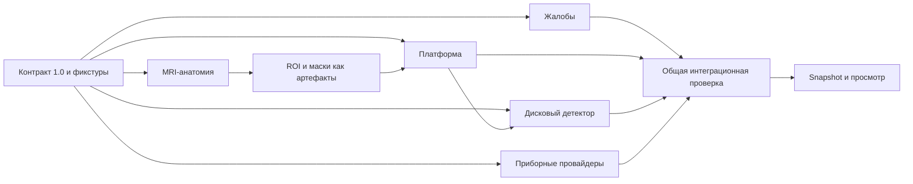

# Параллельная разработка модулей

Дата: 8 октября 2026 года. Порядок работы для ближайшего прототипа.

Разделяем работу по контрактам и владельцам файлов. Модуль может
разрабатываться и проверяться без запуска чужих моделей. Первый общий
результат — один эпизод с наблюдениями из нескольких провайдеров,
доступными свидетельствами и зафиксированным snapshot.

## Сначала фиксируем общую границу

До самостоятельных изменений модулей принимаем контракт 1.0:
запрос, `ModuleResult`, наблюдения, ссылки на артефакты, статусы,
происхождение и ошибки. Исполняемая схема — единственный источник
типов; документация объясняет её, а не определяет альтернативный API.

Владелец контракта собирает согласование потребителей. Изменения,
ломающие совместимость, требуют ручной проверки и новой major-версии.
Добавление необязательного поля допустимо только после проверки
валидаторов и потребителей; не считать его автоматически безопасным.
Версия модели или модуля не заменяет версию общего контракта.

## Разделение задач и владения

Ниже границы владения. Один файл не редактируется параллельно двумя
исполнителями. Общий слой меняет интеграционный владелец: схемы и
`contracts.py`; `ports.py`, `registry.py`, `orchestration.py`, `storage.py`,
`results.py`, `cli.py`, `__main__.py` в `src/dorsopathy_platform/`. Другие владельцы
предлагают изменения контракта через согласование, а не редактируют эти файлы.

| Поток | Владелец и область изменений | Первый проверяемый результат |
|---|---|---|
| Общий контракт | Один владелец схемы и контрактных фикстур | Запросы/результаты валидируются, неизвестные и отрицательные состояния различаются |
| Платформа | Владелец API, реестра, runner, store и snapshots | Задание проходит статусы, сохраняется результат, snapshot воспроизводится |
| Жалобы | Владелец своего пакета в `src/dorsopathy_modules/` и модульных тестов | Структурированные ответы/карта боли с `patient_report`; синтетический demo явно помечен |
| MRI-анатомия | Владелец отдельного adapter-пакета и тестовых экспортов | Сохранённый результат TSS/SpinoSarc читается без повторного инференса; сохраняются единицы, качество, нумерация и evidence |
| Дисковый признак | Владелец собственного provider-пакета, обучения и оценки | Один признак по входному ROI; версия модели и метрики; ROI не называется контуром патологии |
| Приборный модуль | Отдельный владелец на каждый пакет | Один конкретный импорт/измерение и проверка качества на разрешённых данных |
| Просмотр результатов | Владелец UI и его тестов | Карточки наблюдений и свидетельств, partial/failed/unknown видны пользователю |
| Исследовательский CDS | Владелец `src/dorsopathy_cds/` | Принимает согласованные клинические факты; не выводит их автоматически из измерений |

Внутренние provider-пакеты размещаются под `src/dorsopathy_modules/`.
Общие демонстрационные провайдеры — под `src/dorsopathy_modules/demo/`.
Реальный MRI-код остаётся в отдельных checkout:

- `/Users/andrew/Projects/SpinoSarc`;
- `/Users/andrew/.codex/worktrees/7179/med diploma`.

Разработка адаптера не является разрешением менять эти репозитории.
Не копируем их `.venv`, веса и исходные исследования в платформенный Git.
Исправления общего контракта или чужого модуля направляются его владельцу;
локальный обход несовместимости внутри провайдера не заменяет согласование.

## Минимальный комплект каждого провайдера

1. Карточка: `module_id`, версия, задача, входы, выходные concepts,
   ограничения, необходимые зависимости и ресурсы.
2. Реализация `ProviderProtocol.analyze(request, context)`, возвращающая
   словарь `ModuleResult`, без прямых
   изменений эпизодов и вызовов чужих аналитических модулей. Из общего пакета
   модулю нужны только `contracts.py`, `ports.py` и `results.py`; runner,
   SQLite и клинический движок в провайдер не импортируются.
3. Минимальные входная и выходная фикстуры с разрешёнными данными.
   Синтетические файлы и mock-модели отмечаются явно во всех результатах.
4. Проверка общим валидатором и тесты, подтверждающие собственные
   измерения/преобразования, а не только форму JSON.
5. Сценарии неполного входа, непригодных данных и отказа. Отсутствие
   наблюдения не заменяется нулём или нормальным результатом.
6. Происхождение evidence: исходный хеш, кадр/ROI/сегмент времени,
   метод, модель и параметры. Измерения имеют проверяемые единицы.
7. Инструкция локального запуска и сведения о лицензиях используемых
   кода, весов и данных.

Для изменений поведения исполнять предусмотренные `AGENTS.md` проверки.
Проверки программного контракта не являются клинической валидацией.
Длительный MRI-инференс не нужен для обычной проверки платформы: используем
сохранённые экспорты и явно синтетические ответы, проверяя реальную модель отдельно.

## Зависимости и интеграция

Жалобы и MRI-анатомию можно делать параллельно. Обучение дискового
детектора может идти на отдельно подготовленных ROI; его интеграция
с предсказанной анатомией проверяется позже самостоятельным сценарием.
Успешность локализации и классификации не объединяется в одну
необоснованную оценку качества.

Первый интеграционный проход: зарегистрировать demo-провайдеры →
импортировать тестовые входы → выполнить задания → проверить результаты →
открыть evidence → зафиксировать snapshot → повторно прочитать его.
Отказ одного модуля сохраняется отдельным заданием и не стирает
результаты остальных. Следующий проход заменяет один demo-провайдер
адаптером сохранённых MRI-результатов.

Критерий завершения общей ветки: контрактные и интеграционные проверки
проходят; описано, какие провайдеры настоящие, какие импортируют ранее
полученные результаты, а какие синтетические. Не заявляем работу приборов
на пациенте по демонстрации с тестовыми файлами.

Изоляция процессов, управление устройствами, отмена и повторные задания
выделяются в последующие платформенные задачи. Их не следует распределять
как незаметные изменения внутри отдельных аналитических модулей.

Общая архитектура: [architecture_ru.md](architecture_ru.md).
Практический старт своего провайдера: [module_development_ru.md](module_development_ru.md).
