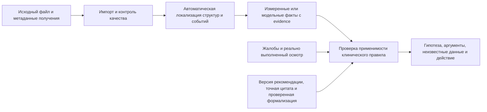

# Сырые данные всех модулей → факты → клинические правила

Дата: 10 октября 2026. Требование к развитию DorsopathyCDS, а не перечень
готовых диагностических возможностей. Текущий код проверен отдельно от
исторических отчётов `research/reuse/`: их старые статусы не означают, что
импортёры до сих пор отсутствуют.

## Цель

Для каждого приборного модуля пользователь загружает исходную запись, а не
готовые маски, контуры, выбранные вручную точки или заключение. Система сама
проверяет пригодность, выделяет нужную структуру/интервал и рассчитывает
признаки. Запись сопровождает небольшой acquisition manifest: устройство,
частота/масштаб, размещение электродов, поза, протокол и известные условия.
Эти сведения нельзя достоверно угадать по массиву пикселей или амплитуде.

Полный путь:

У жалоб исходные данные — ответы пациента и карта боли. У осмотра — реально
выполненные тесты и их результаты. Автоматическая обработка этих данных
не означает, что программа сама выполнила пальпацию, проверила рефлексы или
установила неврологический дефицит.

## Что извлекать и где сейчас пробел

Выходы ниже — целевые требования. Их наличие в таблице не означает готовую
модель, доступные веса, доказанную диагностическую точность или порог нормы.

| Модуль | Исходный вход | Целевая автоматическая аналитика | Текущее состояние и следующий шаг |
|---|---|---|---|
| Жалобы | Ответы, карта боли, при необходимости текст | Сторона, зоны и иррадиация, начало/длительность, интенсивность, связь с движением, ответы на вопросы о настораживающих симптомах; ссылка на каждый ответ | Сейчас только интенсивность/длительность и карта. Добавить подробный versioned questionnaire; текстовое извлечение позже, с подтверждением пациентом |
| Осмотр | Результаты отдельных реально выполненных тестов | Структурировать силу по мышце/стороне, чувствительность, рефлексы, тесты натяжения и их условия; сохранить автора/время/неисследованные пункты | Сейчас четыре уже укрупнённых оценки врача. Нужен гранулярный ввод, а затем отдельно проверенная формализация |
| Поверхностная ЭМГ | Сигнал каналов, временная сетка, масштаб, размещение электродов и протокол задания | QC/артефакты, обработанный сигнал, RMS/envelope, частотные показатели по фазам задания; нормализация и сравнение сторон только при подходящем эталоне | Raw CSV уже обрабатывается, но только ограниченный профиль без фильтра. Добавить документированный экспорт устройства/корпуса и versioned signal worker; не выдавать RMS/MDF за радикулопатию |
| УЗИ поясничных мышц | DICOM single/multiframe или калиброванный кадр/cine с указанием области и протокола | Автоматическая маска конкретной мышцы, пригодность плоскости, толщина/площадь, изменение при сокращении; наложение контура и измерений | Сейчас измерения по ручным точкам/полигону. Нужны raw DICOM worker и модель именно поясничной мышцы; один статический кадр не даёт изменения при сокращении |
| 3D / глубина | Depth/RGB с калибровкой либо метрическое облако/mesh; для движения — последовательность | Автоматические внешние ориентиры, положение туловища/таза, асимметрия; для динамики — диапазон движения и события с погрешностью | Сейчас PLY/OBJ и ручные vertex landmarks; реальный depth→PLY конвертер вне provider. Встроить импорт, подобрать/проверить detector ориентиров. Статический mesh не даёт диапазона движения |
| Термография | Радиометрический файл/поток камеры с её metadata | Температурная матрица, выделение поверхности/сопоставимых ROI, mean/min/max и ΔT, график событий при временной записи; heatmap/QC | Сейчас provider принимает готовую Cel matrix и ручные ROI. Радиометрия публичного примера декодирована отдельно. Встроить decoder и автоматическую локализацию ROI; обычный цветной JPEG не подходит |
| ANI / NOL | Экспорт конкретной модели прибора: индекс, качество, время и события; доступные физиологические каналы отдельно | Пропуски/QC, тренд, baseline/окна/дельты с синхронизацией; сохранить ограничения показаний | Сейчас canonical index import, а не алгоритм производителя по raw ECG/PPG. Сделать отдельные vendor adapters; generic HRV не переименовывать в фирменный ANI/NOL |

`mri.pathology` уже даёт две модельные категории по пяти дисковым уровням;
см. [реальный запуск](mri_pathology_ru.md). Это отдельный источник фактов,
а не автоматически установленная причина боли.

## Какой клинический вывод можно поддерживать

«Дорсопатия» не является одной бинарной целевой меткой для всех датчиков.
Сначала выбирается гипотеза и действие, затем нужные факты и метод их
получения. Следующее разделение — наш план разработки, не классификация
из официальной рекомендации.

| Цель | Используемые данные | Что допускается разрабатывать |
|---|---|---|
| Поддержка гипотезы дискогенной радикулопатии | Жалобы, неврологический осмотр, применимые МРТ-находки; при показаниях отдельное EDX | Проверка отдельных клинических условий, соответствия уровня/стороны и недостающих данных. Наличие бинарной грыжи само по себе недостаточно |
| Описание мышечной функции и её динамики | Поверхностная ЭМГ, УЗИ конкретной мышцы, стандартизированное движение | Проверяемые показатели в заданном протоколе. Диагностические пороги и причинность боли требуют отдельного основания/валидации |
| Описание внешней позы и движения | Калиброванная 3D/динамическая запись | Измерения поверхности/движения. Внешний угол не становится углом Cobb или признаком компрессии корешка |
| Исследовательские сопоставления | Термография, ANI/NOL, жалобы и синхронные события | Описательное сопоставление при пригодных данных. В проверенных источниках не найдено готового правила автономной диагностики дорсопатии по этим комбинациям |

Для каждого целевого вывода требуется карта:

`гипотеза/действие → пункт рекомендации → точная цитата → условие →
нужные observations → пригодность метода → исходные evidence`.

Ссылка на исследование измерительного метода не заменяет рекомендацию по
постановке диагноза. Публикация сегментатора подтверждает задачу сегментации,
а не клинический смысл любой найденной асимметрии. Если основание отсутствует,
выход сохраняется как измерение/исследовательский факт, без диагноза.

## Первичные источники для клинического сопоставления

Ниже проверенные короткие фрагменты и границы их применения. Это материалы
для будущего mapping review; новые исполняемые правила этим документом не
добавлены. Перед активацией нужны frozen source/hash, каталог цитат,
проверенная формализация и тесты неизвестных/противоречивых данных.

1. [КР Минздрава №777_1, 2023](https://apicr.minzdrav.gov.ru/api.ashx?id=777_1&op=GetClinrecPdf),
   раздел 2.2, печатная стр.12, диагностическая триада; редакция и SHA уже
   сохранены в `src/dorsopathy_cds/catalog/sources.json`:
   > Результаты нейровизуализации (при их наличии) имеют прямую корреляцию с клинической картиной
   Это основание для клинического сопоставления, не порог площади канала.
   Текущее правило требует врачебной проверки формализации.

2. [WFNS Spine Committee, рекомендации 2023](https://wfns-spine.org/lower-back-pain-and-lumbar-disc-herniation-recommendations),
   раздел 6, essential diagnostic tests; точные фрагменты списка:
   > evaluation of muscle strength, sensory disturbance, sphincter dysfunction
   > supine straight leg raise, Lasegue sign, and crossed Lasegue sign
   Эти признаки относятся к осмотру; из УЗИ-маски мышцы или поверхностной
   ЭМГ их автоматически не получить. Статья/консенсус не являются допуском ПО.

3. [AANEM, EDX при пояснично-крестцовой радикулопатии](https://www.aanem.org/docs/default-source/documents/aanem/practice/guidelines/utility-of-elec-testing_reaffirmed.pdf?sfvrsn=63dce9e3_1),
   2010, reaffirmed 2017, Conclusions 1(a)/(b), печатная стр.280:
   > Peripheral limb EMG (Class II evidence, Level B recommendation).
   > PM with needle EMG in lumbar radiculopathy
   Поддерживает клиническую роль соответствующего игольчатого исследования
   при подозрении на радикулопатию. Это будущий отдельный EDX-модуль;
   рекомендация не переносится на пассивную поверхностную запись спины.

4. [AANEM, Surface EMG review](https://www.aanem.org/docs/default-source/documents/tech_rvw_surface_emg.pdf?sfvrsn=e90e8023_1),
   2008, Abstract, печатная стр.1219:
   > there are insufficient data to support its utility for distinguishing between neuropathic and myopathic conditions or for the diagnosis of specific neuromuscular diseases.
   Недостаточность доказательств для такой диагностики не означает запрет
   исследовать функциональные показатели. Она не даёт правила RMS→радикулопатия.

5. [FDA, PMD-200 DEN210022](https://www.accessdata.fda.gov/cdrh_docs/reviews/DEN210022.pdf),
   Indications for Use, PDF стр.1; фрагмент:
   > assessment of changes in nociception levels in adult patients under general anesthesia
   Показание относится к общей анестезии и дополнительной клинической оценке;
   оно не обосновывает диагностику хронической дорсопатии у бодрствующего.
   PMD-100 нельзя считать тем же устройством без проверки его документации.

6. [Medasense, PMD-200 US manual](https://medasense.com/wp-content/uploads/2025/11/Medasense-PMD-200-User-manual-2.2.1-MK2U-02-708-English-US.pdf),
   system2.2.1, MK2U-02-708 Rev.2, стр.14,36,39–42,55:
   > has not been thoroughly evaluated in patients with reported alcohol abuse, chronic pain
   Ограничение оценённости хронической боли; в awake-контексте значения могут
   отражать симпатический тонус/стресс. Экспорт Time/NOL index/Heart rate/
   Annotations не превращает приборный индекс в интенсивность субъективной боли.

7. [Jess et al., ANI у сознательных добровольцев](https://pubmed.ncbi.nlm.nih.gov/26266775/),
   первичное исследование, 2016, Abstract Conclusion:
   > ANI does not exclusively detect nociception, but may be modified by stress and emotion.
   Исследование не является универсальным доказательством невозможности любой
   будущей задачи ANI; оно ограничивает уверенную интерпретацию индекса как боли.

[NICE NG59, 1.1.1–1.1.3](https://www.nice.org.uk/guidance/ng59/chapter/Recommendations)
дополняет направление сбора жалоб/альтернативных причин и стратификации риска.
Риск стойких ограничений функции не равен вероятности конкретной дорсопатии.
Не использовать положение о лечебном ultrasound как оценку диагностического УЗИ.

## Независимые задания следующего этапа

| Задание | Результат для интеграции | Что можно переиспользовать |
|---|---|---|
| RAW-INTAKE | Granular complaint/exam profiles, автор каждого факта, отдельный review результата `mri.pathology`; никаких новых диагнозов из текста | Текущие providers; JSON Forms — кандидат интерфейса, не медицинский алгоритм |
| RAW-EMG | Документированный исходный signal export → QC/фильтрация/фазы/признаки и графики; versioned method | Текущий CSV provider; optional NumPy/SciPy, WFDB/LibEMG после проверки конкретного профиля |
| RAW-US | Raw DICOM/cine → масштаб/пригодный кадр → автоматическая маска выбранной поясничной мышцы → измерения | pydicom для импорта. Сегментатор, веса, лицензию и lumbar validation выбрать отдельно; ручной ImageJ не закрывает автоматику |
| RAW-3D | Depth/RGB/PLY → калибровка → автоматические внешние ориентиры; динамика только по реальной последовательности | Open3D для геометрии/IO; detector анатомических ориентиров остаётся отдельной задачей |
| RAW-THERMAL | Документированный radiometric format → Cel matrix/QC → автоматические воспроизводимые ROI → измерения | ExifTool/Thermimage в изолированном процессе; проверка лицензий и camera format обязательна. Decoder не локализует анатомию |
| RAW-NOCI | Adapter выбранной модели/версии → index/quality/time/events → ограниченные по показаниям графики | Текущий canonical provider; vendor CSV adapter. Фирменный индекс заново из HRV не воспроизводим по умолчанию |
| CLINICAL-MAP | Для каждой гипотезы источники/цитаты/популяция/условия/неизвестные; отделение измерений от диагностических predicates | Имеющиеся catalog/engine; независимый клинический review, а не придуманный общий индекс согласованности |

RAW-* могут разрабатываться параллельно с владельцем каждого provider/worker.
Общую схему, dispatcher, clinical catalog и UI меняет интегратор после
согласования. Совместимый `ModuleResult 1.0` сохраняется; дополнительные
метаданные/маски/траектории/ссылки на mapping — versioned artifacts/sidecars,
а не новые неоговорённые поля Observation.

Задание считается завершённым, когда реальный исходный файл проходит весь
путь без заранее приготовленного результата/ручного ROI, есть независимая
проверка извлечения и измерений, видны отказы и evidence, а заявленная
клиническая роль имеет собственное основание. Синтетика проверяет программный
путь, но не качество детектора. Разные открытые корпуса не соединяются в
одного пациента. Нормальные сенсоры не доказывают отсутствие заболевания,
психогенную боль или недостоверность жалоб.
