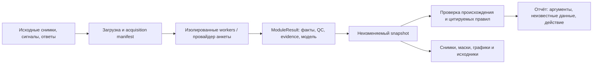

# Исходные данные → факты → проверка правила

Checkout: `/Users/andrew/Projects/DorsopathyCDS`, ветка `feature/multimodal-mvp`.
Работа выполняется отдельными агентами с владением файлами, зафиксированным в
[журнале реализации](raw_implementation_wave_ru.md). Общий контракт
`ModuleResult 1.0` сохранён. Провайдеры `0.1.0` продолжают работать; новый
сырой формат выбирается через версию модуля `0.2.0`.

## Что извлекается автоматически

| Модуль | Вход нового профиля | Выход | Проверенный сценарий / граница |
|---|---|---|---|
| МРТ | Sagittal T2 NIfTI/DICOM, настроенный SpineNet | Модельные категории стеноза и грыжи по пяти дискам, crop evidence | Реальный открытый снимок; уровень требует проверки. Это отдельный уже реализованный `mri.pathology/0.1.0` |
| ЭМГ | Полный исходный CSV/gzip + описание записи | QC, фильтрованные отсчёты, огибающая, RMS, Welch MDF, временные окна и графики | HipBridge, 34 963 отсчёта; 134 MDF рассчитаны. Физический RMS/огибающая неизвестны без масштаба амплитуды |
| Тепловизор | Исходный радиометрический FLIR JPEG + условия съёмки | Counts→°C, автоматический передний план, mean/max, mask/heatmap | Реальный JPEG; mean 32,130°C, max 35,432°C. Область общая: без определения воспаления, стороны и позвонка |
| 3D/depth | DEPTH16 PNG + исходная калибровка XML/JSON | Автоматический объект, облако точек, внешние размеры в осях камеры/PCA | Реальный TEXEL; неполная геометрия камеры снижает качество. Это не угол Cobb и не модель внутреннего позвоночника |
| УЗИ | Исходный PNG/DICOM + плоскость/масштаб | Автоматическая маска multifidus, площадь/толщина при пригодной геометрии | Native UltraSAM3 запущен на реальном KU Leuven кадре: автоматическая маска 14 080 пикселей. Разрыв маски блокирует размеры; продольная плоскость блокирует CSA. [Подробности](ultrasound_raw_ru.md) |
| Ноцицепция | Документированный CSV PMD-200 + кодирование времени | Индекс прибора, ЧСС, записи событий, QC | Фирменный ANI/NOL из PPG не пересчитывается. Импортёр реализован; синтетический CSV прошёл общий backend. Реальный vendor-export пока не найден; качество не экспортируется и остаётся неизвестным |
| Жалобы | Исходные ответы пациента в JSON | Явные симптомы, статус неизвестного ответа, JSON-pointer evidence | `complaints/0.2.0`, анкета в [examples](../examples/complaints_screening/source.json) |
| Осмотр | Исходные явные оценки врача и точный просмотренный результат МРТ | Четыре подтверждённых/неизвестных клинических факта | `clinical.exam/0.1.0`; просмотр можно связать с anatomy или pathology. Дефицит и натяжение не выводятся из площади мышцы |

Отдельные подробности: [ЭМГ](emg_raw_ru.md), [тепловизор](thermography_raw_ru.md),
[3D](lidar_raw_ru.md), [УЗИ](ultrasound_raw_ru.md), [ноцицепция](nociception_raw_ru.md),
[МРТ](mri_pathology_ru.md).

## Общий backend и локальный запуск

`--raw-workers-config` — доверенный файл оператора с ключами `emg.surface`,
`thermography`, `ultrasound`, `lidar.posture`, `nociception`.
Каждый ключ содержит `command` как argv-массив и `timeout_seconds` 1–3600.
Платформа добавляет `--exchange-dir`, проверяет результат и импортирует evidence.
МРТ и тяжёлая модель УЗИ `0.2.0` делят очередь с одним процессом анализа,
чтобы одновременно не загружать несколько больших моделей; лёгкие сенсоры
и прежние ручные УЗИ-измерения продолжают исполняться параллельно.
Команды и пути моделей не принимаются в загруженном source manifest.
[Шаблон](../examples/raw_workers/config.example.json) содержит placeholders;
используйте реальные абсолютные пути окружений и `PYTHONPATH`.
УЗИ имеет собственный worker config с upstream/checkpoint в инструкции модуля.

На текущем компьютере настроен `var/raw-workers.json`. Пример полного пути ЭМГ:

```sh
cd /Users/andrew/Projects/DorsopathyCDS
PYTHONPATH=src python3 scripts/run_raw_input.py \
  --module emg.surface \
  --source examples/emg_raw/hipbridge-acquisition.json \
  --artifact csv_artifact_id application/gzip \
    var/real-inputs/emg/hipbridge-phe-v0.1/original/fd0f5636-phe-1.csv.gz \
  --store var/raw-modules-demo --raw-workers-config var/raw-workers.json \
  --output var/raw-output/emg
```

`--artifact` связывает исходный файл с полем acquisition manifest. Программа
создаёт отдельный episode, загружает source/raw, ставит job, ждёт snapshot,
сохраняет `run.json`, `snapshot.json`, `report.json` и `report.html`.
Для каждого публичного файла создаётся отдельный случай: происхождение разных
людей не превращается в подтверждённую межмодальную связь.

Учебная проверка нового правила (без модели и датчиков):

```sh
PYTHONPATH=src python3 scripts/run_raw_input.py \
  --module complaints --source examples/complaints_screening/source.json \
  --synthetic --store var/screening-demo --output var/screening-output
```

Импорт ноцицепции на явно синтетической записи:

```sh
PYTHONPATH=src python3 scripts/run_raw_input.py \
  --module nociception --source examples/nociception_raw/synthetic-acquisition.json \
  --artifact csv_artifact_id text/csv examples/nociception_raw/synthetic-pmd200.csv \
  --synthetic --store var/raw-modules-demo --raw-workers-config var/raw-workers.json \
  --output var/raw-output/nociception
```

Для браузера, когда CLI не держит это хранилище открытым:

```sh
PYTHONPATH=src python3 -m dorsopathy_platform serve \
  --store var/raw-modules-demo --port 8768 \
  --raw-workers-config var/raw-workers.json \
  --example-catalog var/raw-output/catalog.json
```

Обзор исходных публичных записей: <http://127.0.0.1:8768/real-examples>.
В карточке можно открыть полный прогон, изображения, все измерения и отчёт.
МРТ-демо ранее запущено отдельно: <http://127.0.0.1:8767/real-examples>.

## Что делает решающий слой

1. Проверяет происхождение факта, точную версию producer, source SHA256,
   selector, исходное значение и качество. Предсказание модели не подменяет
   ответ пациента или клиническую оценку врача.
2. Выполняет цитируемое правило NICE NG127 1.7.3: сильная боль в пояснице +
   распространение в ногу + одно из новых нарушений функции мочевого пузыря,
   кишечника, сексуальной функции или онемение промежности → срочная оценка
   по местному маршруту. Это направление для оценки, не диагноз.
3. Сохраняет прежнюю исследовательскую диагностическую триаду КР РФ №777.
   Ей нужны оценки врача, пригодная связь источников и, при наличии, точный
   просмотренный результат MRI. Одна найденная грыжа её не заполняет.
4. Для каждого датчика показывает клиническую роль и границу применимости.
   Для RMS, температуры, внешнего размера и площади мышцы не придуман
   диагностический порог. Нормальные/отсутствующие измерения не исключают
   заболевание и не определяют психогенную боль.

Неоценённый ответ не становится `false`. Состояния правила: `met`, `not_met`,
`indeterminate`; несколько анкет требуют отдельного выбора/эпизода.
Наличие сильной боли не выводится из произвольного числового порога NRS.
Модульная проверка NICE использует одну анкету; измерения другого датчика
не отменяют исходную скрининговую рекомендацию. Смешение synthetic/real
блокирует интерпретацию как реального клинического случая.

## Проверяемый отчёт и источники

Полный экспорт имеет schema `2.0` с добавленным `module_report`:
`facts`, `lineage`, `results`, `module_use`, `catalog_snapshot` и SHA256.
Числовые факты сохранены полностью; evidence и metadata модели хранятся
один раз на результат. `result_sha256` связывает с точным ModuleResult
в snapshot; selectors и времена каждого измерения остаются там.
Старый frozen-отчёт `1.0` продолжает отображаться по своей сохранённой
редакции. Хэш нового отчёта охватывает оба каталога и все новые поля.
Модульный wire `ModuleResult 1.0` и старый standalone CDS API не менялись.

Прямые фрагменты NICE находятся в
[catalog/module_sources.json](../src/dorsopathy_cds/catalog/module_sources.json),
условия и пояснение формализации — в
[catalog/module_rules.json](../src/dorsopathy_cds/catalog/module_rules.json).
Проверен официальный 86-страничный PDF: NG127, обновление 02.10.2023,
copyright 2026, страница 18, пункт 1.7.3.
Дополнительно сохранены PDF AANEM по surface EMG и FDA DEN210022 по PMD-200.
Версии, страницы и хэши фиксированы; PDF находятся в ignored `var/clinical-sources`.

```sh
python3 scripts/verify_module_sources.py
# Для проверки самих фрагментов дополнительно нужен изолированный pypdf:
PYTHONPATH=/private/tmp/dorsopathy-pdf-deps python3 \
  scripts/verify_module_sources.py --check-quotes
```

Все новые клинические mappings имеют `requires_clinical_review`:
проверяемая формализация не означает клиническую валидацию или регистрацию
ПО в РФ, США, Корее. Подробности популяций и методов —
[в клиническом контракте](raw_modules_clinical_contract_ru.md).

## Схема общего прогона



Общий поток одинаков для всех модулей. Измерительный модуль может работать
полностью автоматически, а его диагностическая роль оставаться исследовательской:
проверенное правило для постановки диагноза требуется отдельно.

## Проверка этой реализации

11.10.2026: полный suite — 430 tests, OK, 24 skipped из-за optional imaging
dependencies. Дополнительный прогон raw-тестов в окружении SciPy/pydicom/Torch —
75 tests, OK без пропусков. Проверены hashes и точные фрагменты трёх первичных
PDF, синтаксис UI и fresh application runs всех новых raw-провайдеров.
Проверки относятся к программной реализации и воспроизводимости расчётов.

Сохранённые результаты общего backend:

- `var/raw-output/emg/`, `thermal/`, `lidar/`, `ultrasound/`: реальные открытые входы.
- `var/raw-output/nociception/`, `screening/`: явно синтетические записи.
- В каждой папке: source, manifest, run, snapshot, report JSON и HTML.

Не объединять эти независимые примеры в один пациентский случай.
