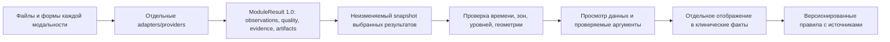

# Что переиспользовать для модулей DorsopathyCDS

Дата проверки: 9 октября 2026 года. Результат этапа — выбор компонентов,
проверка доступных данных и требования к адаптерам. Это не запуск новых
провайдеров и не оценка диагностической точности.

## Рекомендуемый старт

| Модуль | Основа для первой реализации | Вход и проверяемый выход | Открытые данные и основной пробел |
|---|---|---|---|
| [МРТ](mri/report_ru.md) | Существующий importer, TotalSpineSeg step2, геометрия/renderer; SpinoSarc для аксиальных измерений | DICOM/MHA/NIfTI → анатомические маски, ROI дисков, кадры, измерения в физических единицах | SPIDER содержит маски и binary bulging/herniation, но не контуры выпячивания/его размеры. TSS обучен в том числе на SPIDER: отдельный patient split не доказывает независимость всей системы. |
| [Жалобы и осмотр](intake/report_ru.md) | JSON Forms, явные поля стороны/зоны, структурированный ввод врача; body-map как интерфейс | Ответы и исходная форма → значения, автор/время оценки, evidence | Найденные imaging-корпуса не дают связанную историю жалоб и осмотра. Права на опросники и рисунки проверяются отдельно от кода интерфейса. |
| [LiDAR/поверхность тела](lidar/report_ru.md) | Open3D + NumPy; внешние landmarks сначала задаются вручную | PLY/OBJ с известным масштабом → расстояния/углы внешних ориентиров, 3D-overlay | Texel пригоден для технического прототипа, CC BY-NC 4.0. Единицы экспорта требуют проверки; HSRD имеет противоречивые сведения о правах. Поверхность тела не задаёт внутреннее положение позвонков. |
| [Термография](thermography/report_ru.md) | ExifTool + Thermimage в отдельном worker | Поддерживаемый радиометрический файл → матрица температуры, ROI, разность температур | Проверен небольшой FLIR-файл из открытого ледникового корпуса. Он проверяет формат, но не работу на пояснице человека. Нужны условия съёмки и калибровка. |
| [Поверхностная ЭМГ](emg/report_ru.md) | CSV/gzip + NumPy/SciPy; WFDB для соответствующих записей | Сигнал с известными каналами/fs/units → RMS, спектральные показатели, временные окна | HipBridgeEMG имеет поясничные мышцы, но единицы/gain/MVC не подтверждены. Hyser — технический forearm-корпус. Без шкалы нельзя обещать калиброванные амплитуды. |
| [УЗИ](ultrasound/report_ru.md) | pydicom + ImageJ для ручной разметки и эталонных измерений; 3D Slicer как альтернатива | Кадр/маска + региональная калибровка → расстояние/площадь, endpoints, overlay | LUMINOUS тематически подходит для multifidus L5, но лицензия внешнего архива и масштаб TIFF не подтверждены. При неизвестном масштабе доступны просмотр/разметка, а mm/mm² остаются не оценены. |
| [ANI/PMD](nociception/report_ru.md) | Импорт уже рассчитанных прибором индексов: pandas + Plotly | Подтверждённый vendor export → индекс во времени, события, качество | Открытый PMD100 dataset содержит агрегированные показатели, не сырой временной экспорт. Проверенного открытого ANI/NOL export с timestamps/quality не найдено; generic ECG/PPG его не заменяет. |
| [Сопоставление](comparison/report_ru.md) | Существующие snapshots/artifacts; детерминированная проверка совместимости. BIDS conventions, MNE/SimpleITK только для конкретных операций | Результаты модулей + clocks/transforms → сопоставимые наблюдения либо причина несовместимости/неизвестности | putEMG связывает sEMG/RGB/depth в экспериментах с кистью. Единого проверенного корпуса всех целевых модальностей с поясничной МРТ не найдено. |

Для будущего патологического классификатора МРТ SpineNet — условный кандидат:
категории по уровням есть, контура и размеров грыжи нет; условия ограничивают
код, веса и outputs некоммерческими исследованиями. Для собственного обучения
binary bulging уже есть локальные SPIDER ROI/метки; обучение в этом этапе не
проводилось. Подробности, версии и первичные ссылки — в модульных отчётах и
их `candidates.json`.

## Как собирать независимо

Общий слой хранит результаты и ссылки на доказательства. Форматы приборов,
ML-окружения и обработка сигналов принадлежат отдельным провайдерам.
Новые метаданные геометрии/приборов размещаются в artifacts/sidecars по
согласованной схеме; расширять общий контракт без координации не нужно.

Сначала интегратор закрывает T00: IDs модулей, concepts, units и fixtures.
После этого в отдельных ветках можно параллельно делать импорт форм,
геометрию LiDAR, радиометрический decoder, ЭМГ features, УЗИ measurement,
MRI worker и адаптер подтверждённого vendor export. Провайдеры имеют общий
критерий сдачи: разрешённый небольшой вход → валидный ModuleResult →
artifact/evidence → воспроизводимое измерение. T16 потребляет эти результаты,
а не импортирует внутренний код каждого аналитического модуля.

## Границы результата

- Код, веса, данные, опросники и body assets имеют отдельные права. Сводка не
  заменяет правовую проверку и не означает регистрацию медицинского изделия.
- Исследователи проверяли upstream, документацию, локальные manifests и
  отдельные небольшие файлы. Новый end-to-end inference не запускался;
  существующий MRI cache не переименовывается в свежий результат.
- Наблюдение с неизвестной шкалой, геометрией, временем или numbering не
  превращается в отрицательную находку. Ограничение сохраняется в результате.
- Объединение разных открытых datasets позволяет показать технические
  интерфейсы, но не создаёт мультимодальную историю одного пациента.
- Spatial/time compatibility не является диагностическим процентом. Новые
  клинические правила и автоматическое превращение измерений в диагноз в этом
  этапе не добавлялись.

Рабочие каталоги, владельцы, ветки и коммиты: [организация](README.md) и
[машиночитаемый журнал](dispatch.json).
